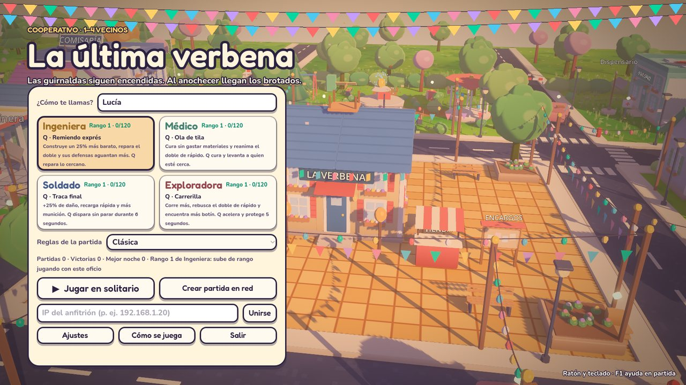
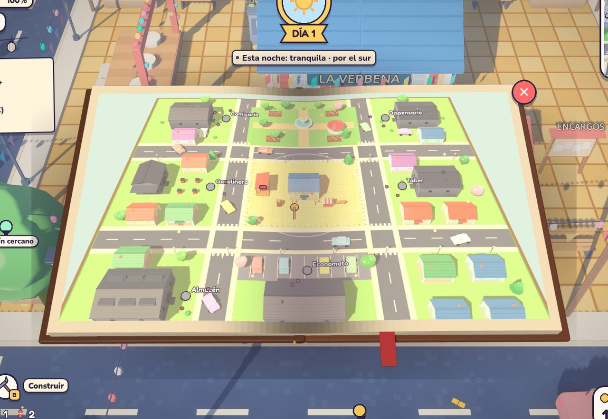
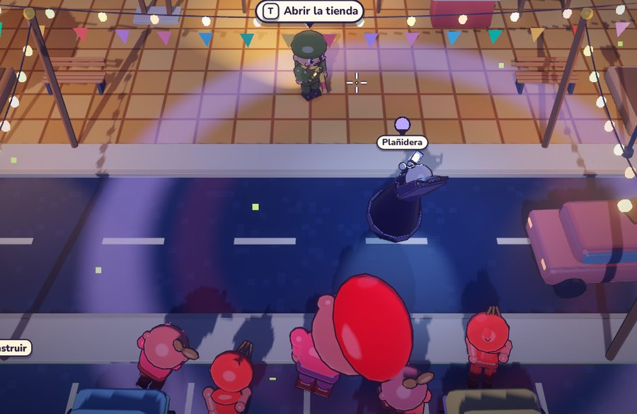
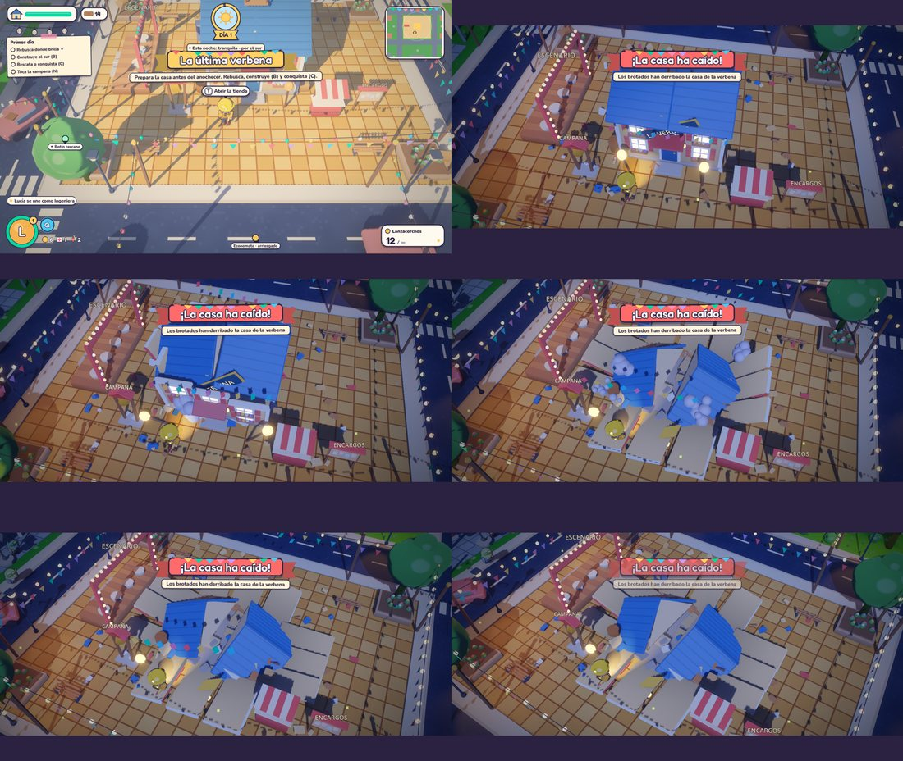
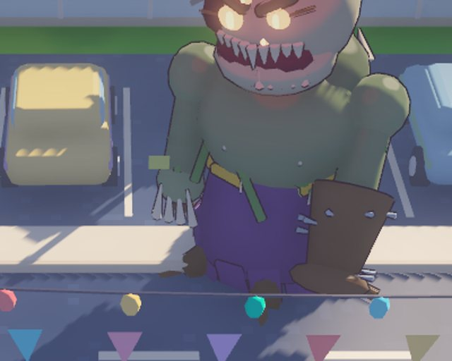
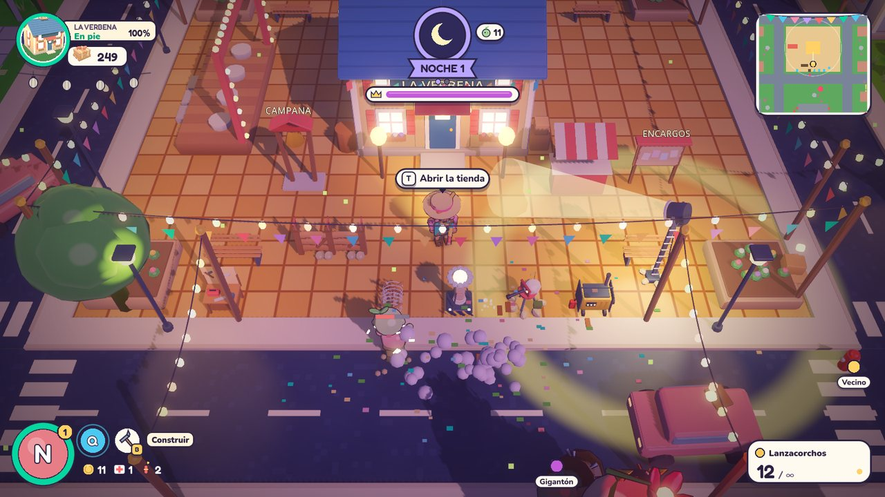
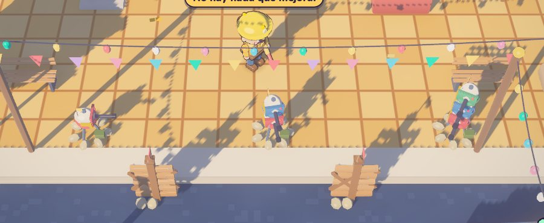
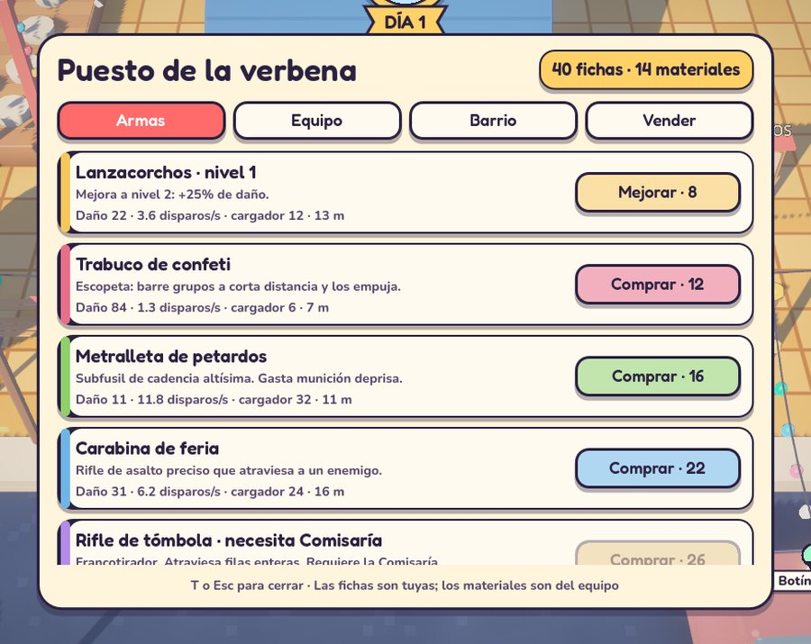
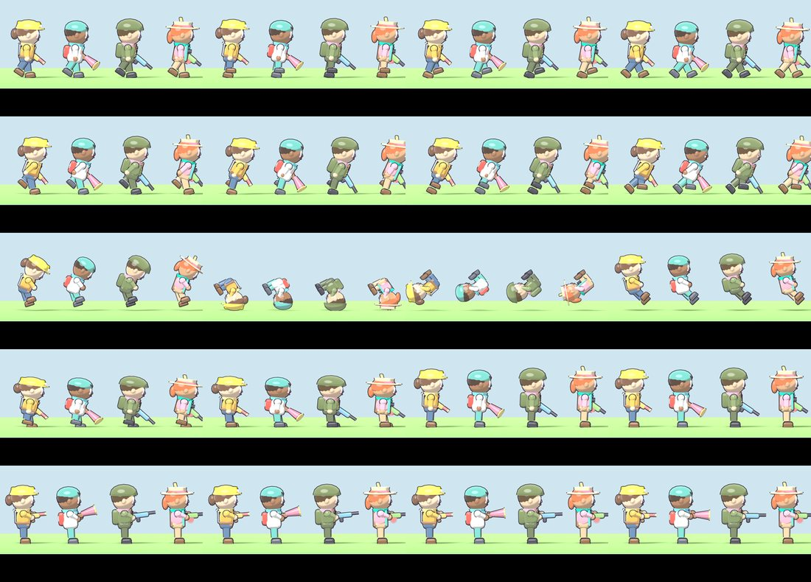
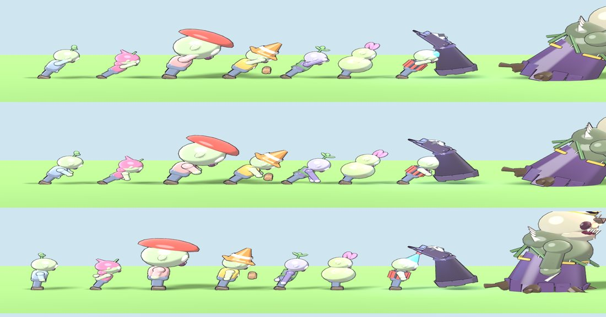

<div align="center">

# 🎆 La última verbena

### Supervivencia cooperativa en 3D · de 1 a 4 vecinos · un barrio español en fiestas

*Las guirnaldas siguen encendidas y los vecinos se han atrincherado en la casa de la verbena.<br>
Al anochecer llegan los **brotados**: vecinos convertidos en plantas con muy malas pulgas.*


**[▶ Jugar](#-cómo-jugar)** · **[🎮 Controles](#-controles)** · **[🌗 Una partida](#-el-ciclo-de-una-partida)** · **[🧟 Brotados](#-los-brotados)** · **[🧱 Defensas](#-construcción-y-territorio)** · **[🛠 Desarrollo](#-para-desarrolladores)**

</div>

---

## ✨ En pocas palabras

| ☀️ De día | 🌙 De noche | 🌅 Al amanecer |
| :-- | :-- | :-- |
| Rebuscas en coches y contenedores, rescatas vecinos, conquistas propiedades y levantas defensas alrededor de la casa. | Los brotados entran por las calles anunciadas, en dos o tres asaltos. Aguanta, repara y reanima a tus compañeros. | Cobras las recompensas, compras armas, mejoras defensas y te preparas para una noche más dura. |

> 🎯 **La meta:** recuperar las cuatro piezas del escenario, **encender la verbena** y aguantar la gran noche final. Si cae la casa… se acabó la fiesta.

<table>
<tr>
<td width="50%"><br><sub><b>De día</b> · el equipo prepara la plaza con su lista de tareas.</sub></td>
<td width="50%"><br><sub><b>Menú</b> · elige nombre, oficio y reglas de la partida.</sub></td>
</tr>
<tr>
<td><br><sub><b>El plano</b> · una maqueta 3D del barrio impresa en un libro que se abre.</sub></td>
<td><br><sub><b>Medianoche</b> · el lamento de la Plañidera enfurece a los brotados.</sub></td>
</tr>
</table>

---

## 📖 Índice

1. [▶ Cómo jugar](#-cómo-jugar)
2. [🎮 Controles](#-controles)
3. [🌗 El ciclo de una partida](#-el-ciclo-de-una-partida)
4. [👷 Oficios](#-oficios)
5. [🔫 Armas y combate](#-armas-y-combate)
6. [🧟 Los brotados](#-los-brotados)
7. [🧱 Construcción y territorio](#-construcción-y-territorio)
8. [🪙 Economía, tienda y comunidad](#-economía-tienda-y-comunidad)
9. [🎨 Arte, animación e interfaz](#-arte-animación-e-interfaz)
10. [🛠 Para desarrolladores](#-para-desarrolladores)
11. [📜 Créditos y licencias](#-créditos-y-licencias)

---

## ▶ Cómo jugar

### Opción A · Versión para Windows

1. Descomprime `LaUltimaVerbena-win64.zip` en cualquier carpeta.
2. Abre **`LaUltimaVerbena.exe`**.
3. Escribe tu nombre, elige un oficio y pulsa **Jugar en solitario**.

> 💡 El ZIP se genera con `python distribution/empaquetar.py` (todos los detalles en [DISTRIBUCION.md](distribution/DISTRIBUCION.md)).

### Opción B · Desde el código

1. Instala **[Godot 4.7](https://godotengine.org/)** (probado con 4.7.2).
2. Abre `project.godot` y pulsa **F5**, o ejecuta:

```bash
godot --path .
```

El juego usa el renderizador **Forward+**. Si tu tarjeta no admite Vulkan, Godot pasa solo al de compatibilidad.

### 👥 Jugar con amigos

| Paso | Quién | Qué hace |
| :--: | :-- | :-- |
| 1 | Anfitrión | Pulsa **Crear partida en red**. Aparece un aviso con sus IP locales. |
| 2 | Hasta 3 amigos | Escriben esa IP y pulsan **Unirse** (también con la partida ya empezada). |
| 3 | Anfitrión | Permite **UDP 24680** en su cortafuegos. |

- 🌐 Por Internet hace falta una dirección accesible o una red privada compartida (Tailscale, ZeroTier…).
- 🔁 Si la sesión se corta, el menú ofrece **Continuar partida** desde el último amanecer y cada vecino recupera lo suyo con su mismo nombre.
- ⚠️ La partida termina si sale el anfitrión.

---

## 🎮 Controles

<table>
<tr><th>🏃 Movimiento y cámara</th><th>⚔️ Combate</th></tr>
<tr valign="top"><td>

| Acción | Tecla |
| :-- | :--: |
| Moverse (relativo a la cámara) | `W` `A` `S` `D` |
| Correr | `Mayús` |
| Voltereta | `Espacio` |
| Acercar / alejar la cámara | 🖱 Rueda |
| Girar la cámara | 🖱 Arrastrar con botón derecho |

</td><td>

| Acción | Tecla |
| :-- | :--: |
| Apuntar y disparar | 🖱 Ratón · clic izquierdo |
| Sartenazo | `V` · clic derecho corto |
| Recargar · cambiar de arma | `R` · `1`–`7` |
| Habilidad del oficio | `Q` |
| Traca · botiquín | `F` · `H` |

</td></tr>
<tr><th>🔨 Construir y gestionar</th><th>🤝 Equipo</th></tr>
<tr valign="top"><td>

| Acción | Tecla |
| :-- | :--: |
| Modo construcción | `B` |
| Elegir defensa | `1`–`8` · 🖱 Rueda |
| Colocar · mejorar · desmontar | Clic · `F` · `X` |
| Rebuscar, reparar, reanimar… | Mantener `E` |
| Tienda (junto a la casa) | `T` |
| Conquistar propiedad | `C` |

</td><td>

| Acción | Tecla |
| :-- | :--: |
| Plano del barrio | `M` · `Tab` |
| Señalar un punto | Clic en el plano · clic central |
| Pedir apoyo (también caído) | `G` |
| Listo para la noche | `N` |
| Ayuda · pausa | `F1` · `Esc` |

</td></tr>
</table>

> ⚙️ Todas las teclas se cambian en **Ajustes → Controles**. Allí también están la sensibilidad, los volúmenes, el tamaño de la interfaz y la accesibilidad (sacudidas, destellos y números de daño). La ayuda (`F1`) siempre muestra tus teclas.

---

## 🌗 El ciclo de una partida

### ☀️ Día · preparación

El medallón de arriba marca cuánto falta para el anochecer y avisa del **evento de la noche** y de **por qué calles** entrarán los brotados.

- 🔍 **28 puntos de botín** (coches, contenedores, palés, cajas de feria, botiquines y cajas de munición) que se rellenan cada amanecer.
- 🆘 **Vecinos atrapados** en casas custodiadas: si los liberas, se unen a la comunidad.
- 🎈 **Globos de feria** que dejan caer suministros.
- 🧟 **Hordas errantes** y brotados sueltos rondando las calles.
- 🔔 Si todos tocan la **campana** de la plaza (o pulsan `N`), la noche llega antes.

> 🌱 El primer día, una nota de papel con pasos y dos marcas en pantalla (botín cercano y una propiedad arriesgada) guían a quien empieza.

### 🌙 Noche · supervivencia

Los brotados llegan en grupos por los frentes anunciados, a por la casa y a por los estandartes de tus propiedades. Cada uno decide si **rodear** tus defensas o **romperlas**, persigue a quien ve y golpea lo que le cierra el paso. La noche llega en **dos o tres asaltos**, con **15 segundos de respiro** entre uno y otro.

| Evento | Qué pasa |
| :-- | :-- |
| 🌌 **Serena** | Oleada normal. |
| 🔌 **Apagón** | Sin corriente salvo junto a un generador. Solo quedan las linternas. |
| 🏃 **Estampida** | Muchos más corredores. |
| 🌫️ **Niebla** | Bruma lechosa y más trepadores. |
| ⛈️ **Tormenta** | Lluvia y rayos que caen al azar sobre todo. |
| 🌕 **Verbena roja** | Luna roja: brotados más rápidos y más fichas. |
| 👹 **Noche de gigantes** | Cada cinco noches llega un **Gigantón**. |

> 🕛 **Medianoche.** Desde la segunda noche, a mitad de la noche suena una campana grave y aparece la **Plañidera** (salvo en las noches del Gigantón). Más detalles en [Los brotados](#-los-brotados).

### 🌅 Amanecer · recuperación

Llegan las recompensas de propiedades y vecinos, vuelven los caídos y se repone el botín. Es el momento de comprar, mejorar y reparar. La partida se guarda sola en cada amanecer.

### 🎆 La meta: encender la verbena

1. Cuatro propiedades guardan una pieza del escenario: **cuadro eléctrico, guirnalda maestra, altavoces y bidón de gasoil**.
2. Al conquistarlas, lleva cada pieza al **escenario** de la plaza. Quien la carga va más despacio y la suelta si cae.
3. Con las cuatro instaladas, enciende la verbena: empiezan **120 segundos** de ataque por todas las calles.
4. Si la casa aguanta, **¡ganáis!** Y después, revancha con el mismo grupo.

> 💀 **Derrota.** Si cae la casa, la cámara se gira hacia ella y se ve cómo se derrumba pieza a pieza. También se pierde si cae todo el equipo. Un jugador caído aguanta 30 s: un compañero lo reanima manteniendo `E`, o él mismo con un botiquín.

<p align="center"><br><sub>El derrumbe de la casa: las paredes se parten y caen hacia fuera, el tejado se dobla en V y queda una nube de polvo.</sub></p>

### 🎲 Reglas opcionales

| Regla | Cambio |
| :-- | :-- |
| **Clásica** | La experiencia base. |
| **Barrio a oscuras** | Apagón cada noche, un globo diario y más fichas. |
| **Estampida** | Un frente más, el doble de corredores y días cortos con más materiales. |

---

## 👷 Oficios

Todos pueden construir, reanimar y usar cualquier arma, pero cada oficio brilla en algo.

| Oficio | Ventajas | Habilidad `Q` |
| :-- | :-- | :-- |
| 🔧 **Ingeniera** | Construye un 25 % más barato, repara el doble y sus defensas aguantan un 20 % más. | **Remiendo exprés** · repara todo lo cercano. |
| 🩺 **Médico** | Cura sin gastar materiales, reanima el doble de rápido y empieza con dos botiquines. | **Ola de tila** · cura y levanta a quien esté cerca. |
| 🪖 **Soldado** | +25 % de daño, recarga rápida y un 50 % más de munición. | **Traca final** · 6 s de fuego rápido sin gastar balas. |
| 🧭 **Exploradora** | Corre más, rebusca el doble de rápido y saca un 50 % más de botín. | **Carrerilla** · 5 s más rápida y con la mitad de daño. |

📈 **Progresión.**
- **En la partida:** cada oficio sube **cinco niveles** (más vida, mejor oficio y habilidad que recarga antes).
- **Entre partidas:** acumula experiencia y sube de **rango**.
  - **Rango 2:** materiales extra, tres botiquines, el trabuco de inicio o fichas, según el oficio.
  - **Rango 3:** +15 de vida para todos.

---

## 🔫 Armas y combate

| Arma | Tipo | Cargador | Alcance | Notas |
| :-- | :-- | :--: | :--: | :-- |
| 🍾 **Lanzacorchos** | Pistola | 12 | 13 m | Munición infinita. No se vende. |
| 🎉 **Trabuco de confeti** | Escopeta | 6 | 7,5 m | 7 perdigones que empujan. |
| 🧨 **Metralleta de petardos** | Subfusil | 32 | 11 m | Cadencia altísima. |
| 🎯 **Carabina de feria** | Rifle de asalto | 24 | 16 m | Atraviesa a un enemigo. |
| 🎟️ **Rifle de tómbola** | Francotirador | 5 | 28 m | Atraviesa filas. Requiere la Comisaría. |
| 💥 **Lanzatracas** | Explosivos | 4 | 13 m | Daño en área. Requiere la Comisaría. |
| 🔥 **Soplete de verbena** | Lanzallamas | 90 | 5 m | Quema en cono. Requiere la Gasolinera. |
| 🍳 **Sartén** | Cuerpo a cuerpo | — | 1,9 m | Siempre a mano. |

Cada arma se **mejora dos veces** en la tienda (+25 % de daño por nivel). Además hay **tracas** arrojadizas, **golpes críticos** y daño extra contra brotados deslumbrados por un foco.

#### 💫 Sensación al disparar

- **Mira viva:** se abre con cada disparo y al moverte, marca los impactos (dorada en los críticos) y las bajas, muestra un anillo de recarga y se vuelve roja con el cargador vacío, con su clic en seco.
- **Peso:** cada arma tiene su retroceso y empuja la cámara en la dirección de tiro. El personaje gira al instante hacia el puntero al disparar.
- **Balas que se ven:** proyectiles con estela que salen de la boca del arma, con fogonazo, humo, casquillos e impactos distintos si aciertas o fallas.
- **Sin pausas tontas:** la recarga empieza sola al gastar la última bala.

---

## 🧟 Los brotados

| | Tipo | Desde | Rasgo |
| :--: | :-- | :--: | :-- |
| 🌱 | **Brotado** | Noche 1 | El común. Algunos arrastran una pierna. |
| 💨 | **Corredor** | Noche 2 | Rápido y frágil, corre agachado con los brazos atrás. |
| 🍄 | **Cabezudo** | Noche 3 | Cabeza enorme con sombrero de seta. Aguanta y pega fuerte. |
| 🚧 | **Derribador** | Noche 3 | Cono de tráfico y viga. Destroza barricadas. |
| 🧗 | **Trepador** | Noche 4 | Brazos largos: escala tus defensas en lugar de romperlas. |
| 🌸 | **Escupidor** | Noche 4 | Barriga hinchada; escupe desde lejos. |
| 🧨 | **Petardero** | Noche 5 | Chaleco de petardos. Explota y hiere también a otros brotados. |
| 👹 | **Gigantón** | Cada 5 noches | Jefe: pisa en área, convoca brotados y hace temblar el suelo. |
| 🕯️ | **Plañidera** | Medianoche, noche 2+ | Evento especial (ver abajo). |

<table>
<tr>
<td width="34%" valign="top"><br><sub><b>El Gigantón</b> · un gigante de feria reventado desde dentro: raíces, espinas, fauces, cuatro ojos rojos, garras y un garrote con clavos.</sub></td>
<td width="66%" valign="top">

#### 🕯️ La Plañidera

Llega a **medianoche** a partir de la segunda noche (nunca en las del Gigantón), anunciada por una campana grave.

- Una figura de luto con **peineta, mantilla y un farol frío** que **flota** sin dar pasos.
- Se mantiene **lejos** de los jugadores.
- Cada 8 s lanza un **lamento** que enfurece hasta a **6 brotados** a su alrededor: se tiñen de rojo y van más rápidos.
- Si se queda sola, o pasa más de un minuto, **se desvanece**.
- Aparece en el plano y con un marcador en pantalla.

> 🎯 **Consejo:** derribadla rápido o los brotados que la rodean se os echarán encima.

</td>
</tr>
</table>

La dificultad crece con **nuevas mezclas**, más frentes, eventos y presión sobre tu territorio, no solo con más vida.

---

## 🧱 Construcción y territorio

Se construye en cuadrícula, a menos de **11,5 m de la casa** o **7,5 m del estandarte** de una propiedad conquistada.

| Defensa | Coste | Función | Niveles |
| :-- | :--: | :-- | :--: |
| 🪵 **Barricada** | 3 | Bloquea el paso (casi 2 m). Los vecinos la saltan. | Madera → tablones → chapa |
| 🌀 **Alambrada** | 2 | Frena y araña a los brotados. | 3 |
| ⚡ **Bobina** | 6 | Descarga eléctrica en cadena. | 3 |
| 🔫 **Torreta** | 9 | Dispara sola. **Apila otra encima para hacerla doble y triple.** | 3 |
| 🔋 **Generador** | 8 | Corriente en los apagones y torretas más rápidas. | 2 |
| 🔦 **Foco** | 4 | Ilumina su zona, sigue al brotado más cercano y deslumbra: van lentos y reciben más daño. | 2 |
| 🛠️ **Banco de taller** | 10 | Repara lo cercano y fabrica tracas. | 2 |
| 💣 **Mina de petardos** | 3 | Estalla al pisarla. Un solo uso. | 1 |

<table>
<tr>
<td width="50%"><br><sub>De noche los focos marcan su zona en el suelo y siguen a los brotados.</sub></td>
<td width="50%"><br><sub>Torreta simple, doble y triple: cada una dispara a su propio blanco.</sub></td>
</tr>
</table>

### 🏳️ Propiedades

Cada una tiene **estandarte, ventaja y guardianes**: despéjalos de día antes de pagar la conquista.

| Propiedad | Ventaja |
| :-- | :-- |
| 🔧 **Taller** | Defensas más baratas y reparación de la casa al amanecer. |
| ➕ **Dispensario** | Curas y botiquines. |
| 🛒 **Economato** | Fichas. |
| 📦 **Almacén** | Materiales. |
| ⛽ **Gasolinera** | Corriente garantizada y soplete. |
| 🚓 **Comisaría** | Armas pesadas, munición y tracas. |

> ⚖️ Cada conquista encarece la siguiente, añade brotados a cada noche y suma un estandarte que intentarán derribar.

---

## 🪙 Economía, tienda y comunidad

| | Materiales 🪵 | Fichas 🪙 |
| :-- | :-- | :-- |
| **De quién** | De todo el equipo | De cada jugador |
| **Para qué** | Construir, reparar, conquistar y reforzar la casa | Armas, mejoras, munición, botiquines y tracas |



**🛍️ El puesto de la verbena** (`T` junto a la casa) tiene cuatro pestañas:

- **Armas:** comprar y mejorar.
- **Equipo:** botiquines, tracas y **lotes** para un compañero.
- **Barrio:** reforzar la casa y ver las propiedades.
- **Vender:** recupera la mitad de lo invertido.

**📋 Tablón de encargos.** Cada día ofrece uno **corto** y otro **ambicioso**: búsqueda, transporte, defensa o un **relevo eléctrico** perdido, que la exploradora localiza y la ingeniera instala.

**🏘️ Comunidad.** Los vecinos rescatados trabajan en casa o en una propiedad, cuya ventaja sube un 50 %:
- **Carpintero:** materiales cada amanecer.
- **Enfermera:** cura en la plaza.
- **Vigía:** dispara desde el tejado.

<br clear="right">

---

## 🎨 Arte, animación e interfaz

> 🎨 **Todo se genera por código:** modelos, sombreado, efectos, iconos, música y sonido. No hay texturas ni modelos externos; solo se incluyen dos fuentes libres.

Estilo de colores suaves y volúmenes redondeados, inspirado en los juegos de Nintendo, con identidad propia: **un barrio español en fiestas** con banderines, farolillos y guirnaldas.

<details>
<summary><b>🌈 Mundo y ambiente</b></summary>

- **Sombreado toon propio:** luz suave, borde de luz, brillo plástico y ventanas que se encienden solas al anochecer.
- **Ciclo de día y noche continuo:** mañana, tarde dorada, atardecer rosado y noche azul con luna, estrellas y guirnaldas.
- **Clima:** nubes con sombra, lluvia con suelo mojado, niebla, relámpagos y luna roja.
- **Vida:** césped y árboles al viento, mariposas, luciérnagas, humo de chimeneas y una fuente con agua animada.
- **Posproceso:** bloom, oclusión ambiental, niebla de altura, desenfoque en Ultra y viñeta.

</details>

<details>
<summary><b>🏃 Animación de personajes y brotados</b></summary>

<p align="center"></p>

- **Pasos sin patinar:** el pie apoyado retrocede a la velocidad del suelo y la zancada se ajusta a la velocidad real.
- **Peso e inercia:** el cuerpo se inclina al acelerar y frenar, la cabeza estabiliza, el arma retrocede y se asienta, y los golpes hacen encogerse.
- **Correr:** inclinación, brazos bombeando, polvo en cada paso y la cámara abre la vista.
- **Voltereta y saltos:** bola, aterrizaje con aplastamiento y polvo; las barricadas se saltan con impulso.
- **Recarga en fases:** inclinar, coger el cargador, encajar y montar. El sartenazo carga, golpea con la cadera y acompaña.
- **Rebuscar:** el personaje se inclina hacia el coche, el maletero se abre y salen latas y tornillos.

<p align="center"></p>

- **Brotados:**
  - **Andar propio:** cada tipo camina a su manera, con brazos y cabeza flojos y espasmos.
  - **Ataque:** se echan atrás, levantan los brazos y se lanzan.
  - **Impactos:** se encogen en la dirección del disparo.
  - **Aparecer:** salen arañando del suelo.
  - **Morir:** caen y se hunden en vez de desaparecer.

</details>

<details>
<summary><b>🧭 Interfaz</b></summary>

- **HUD limpio** con tema de papel y tinta: medallón de día y noche, retrato 3D de la casa con su anillo de resistencia, farolillos de las piezas, insignia del oficio, tarjeta del arma y avisos sobre la cabeza del personaje.
- **Plano en un libro 3D:** la tapa de cuero se abre, se pasan las hojas y aparece una maqueta 3D del barrio impresa en las páginas. El minimapa es la misma maqueta y gira con la cámara.
- **Fuentes redondeadas** Fredoka y Nunito, e iconos dibujados por código.

</details>

---

## 🛠 Para desarrolladores

<details open>
<summary><b>🗂️ Estructura del proyecto</b></summary>

| Archivo | Responsabilidad |
| :-- | :-- |
| `game/data.gd` | Datos de diseño: oficios, armas, brotados, defensas, propiedades, eventos y vecinos. |
| `game/map.gd` | Trazado del barrio alineado a la cuadrícula de navegación, coches incluidos. |
| `game/nav.gd` | Cuadrícula, colisiones (también cajas orientadas de coches), rayos y campos de flujo. |
| `game/match.gd` | Simulación autoritativa: fases, IA, combate, economía, territorio y eventos. |
| `game/main.gd` | Sesión ENet, entradas, predicción local y reparto de eventos a efectos, audio e interfaz. |
| `game/view/world.gd` | Barrio, vegetación, luces, ciclo de día, clima y derrumbe de la casa. |
| `game/view/actors.gd` · `rig.gd` | Modelos de héroes, brotados y defensas, y su animación por capas. |
| `game/view/fx.gd` | Efectos con reservas de objetos reutilizables. |
| `game/view/camera_rig.gd` | Cámara continua de vista táctica a tercera persona. |
| `game/audio.gd` | Síntesis de efectos y música. |
| `game/interface.gd` | Menús, ajustes, tienda, tablón, plano, pausa y final. |
| `game/ui/hud.gd` · `style.gd` | HUD dibujado por código, paleta, fuentes e iconos. |
| `game/ui/book3d.gd` · `map3d.gd` · `portrait.gd` | Libro 3D del plano, maqueta del barrio y retratos 3D. |
| `game/settings.gd` · `profile.gd` · `checkpoint.gd` | Preferencias, progreso entre partidas y guardado al amanecer. |

</details>

<details>
<summary><b>🌐 Red, guardado y rendimiento</b></summary>

- **Red:**
  - El anfitrión decide todo lo que afecta al resultado.
  - Cada cliente predice su movimiento y sus disparos, y envía controles a 30 Hz.
  - Las instantáneas viajan comprimidas a 20 Hz: unos 2 KB con decenas de brotados.
  - Los eventos llevan número de serie y se repiten, así que una pérdida de paquete no borra efectos.
- **Versiones:** el anfitrión explica por qué rechaza una conexión (versión distinta, partida llena o terminada).
- **Guardado:** al amanecer en `user://` con escritura segura. El registro de partida va en `user://registros/` para las pruebas con jugadores.
- **Rendimiento:**
  - Hasta 72 brotados activos, con cubos espaciales para buscar vecinos, MultiMesh para la vegetación y efectos reutilizados.
  - Cuatro niveles gráficos.
  - Unos 7 ms de CPU por fotograma con más de 70 brotados.

</details>

<details>
<summary><b>🧪 Pruebas</b></summary>

```bash
godot --headless -s tests/match_test.gd     # 42 reglas de la simulación
```

| Prueba | Qué comprueba |
| :-- | :-- |
| `match_test.gd` | Construcción, rutas, coches sólidos, tienda y venta, disparo, conquista, torretas apilables, la Plañidera, derrotas… |
| `coop_test.gd` | Plano, señales, brechas y petición de ayuda. |
| `shop_ui_test.gd` | Clics reales en la tienda mientras la partida sigue. |
| `goal_test.gd` | Piezas, noche final, victoria, derrota y revancha. |
| `camera_test.gd` | Movimiento relativo a la cámara, giro, zoom y puntería. |
| `jobs_test.gd` · `decisions_test.gd` | Encargos, destinos de los vecinos y reglas opcionales. |
| `profile_test.gd` · `checkpoint_test.gd` · `settings_test.gd` | Rangos, guardados y ajustes, incluida la recuperación de archivos a medias. |
| `soak_test.gd` | Cuatro bots juegan varias noches y se mide el coste de cada paso. |
| `network_test.gd` · `join_test.gd` | Anfitrión y clientes ENet reales; sala llena y versión distinta. |
| `run_session.py` | Tres noches en red con latencia simulada; compara el estado final en todos los procesos. |
| `benchmark.gd` | Oleada llena en cada calidad gráfica. |

```bash
python tests/run_session.py --jugadores 2 --noches 3
```

</details>

📌 Las prioridades y los criterios de prueba están en **[TODO.md](TODO.md)**.

---

## 📜 Créditos y licencias

- **Motor:** [Godot Engine](https://godotengine.org/) 4.7.2, licencia MIT.
- **Fuentes:** [Fredoka](https://github.com/google/fonts/tree/main/ofl/fredoka) y [Nunito](https://github.com/google/fonts/tree/main/ofl/nunito), SIL Open Font License 1.1 (textos en `game/fonts/`).
- **Todo lo demás** (modelos, sombreado, efectos, iconos, música y sonido) se genera por código en este repositorio.

El inventario completo está en [distribution/licencias/Materiales.txt](distribution/licencias/Materiales.txt).

<div align="center">
<br>

**¡Que no se apague la verbena!** 🎆

</div>
