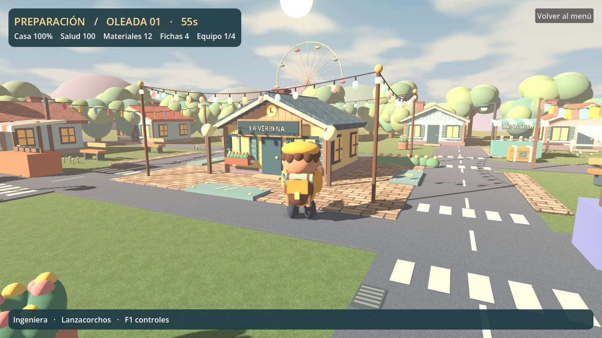
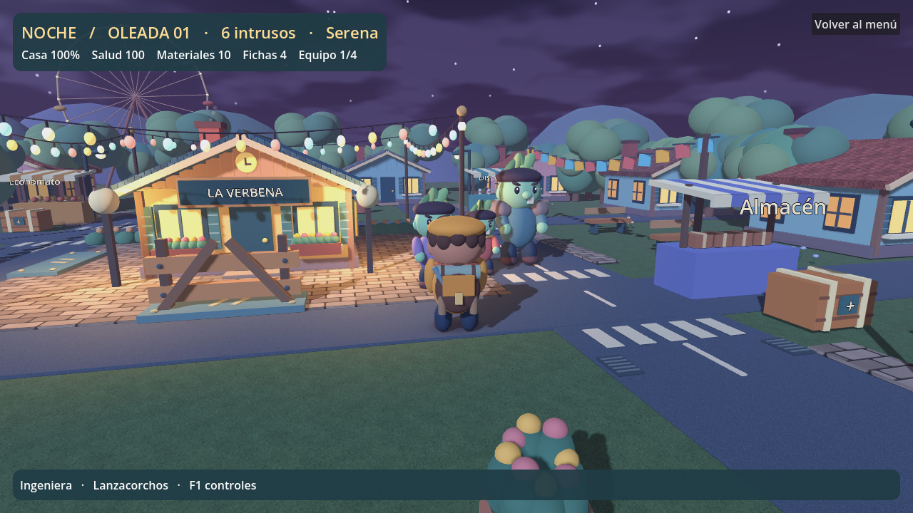

# La última verbena

Supervivencia cooperativa en 3D para PC. Las guirnaldas siguen encendidas y los vecinos se han atrincherado en la casa de fiestas. Al anochecer llegan los brotados. El equipo decide si gasta sus últimos materiales en una bobina para la próxima oleada o en recuperar el taller de la calle.

## Jugar

Abre `project.godot` con Godot 4.7.2 y pulsa **F6** en `game/main.tscn`, o **F5** desde el proyecto. Desde la terminal, ejecuta `godot --headless --import` al descargar el proyecto por primera vez y después `godot --path .`. Selecciona tu rol y pulsa **Jugar en solitario**.

Para jugar en red, una persona pulsa **Crear partida en red**. Hasta tres compañeros introducen la IP del anfitrión y pulsan **Conectarse**. Todos deben usar la misma versión. En una LAN basta con permitir UDP 24680 en el cortafuegos del anfitrión. Para conexión directa por Internet hace falta una dirección accesible o una red privada compartida. La sesión termina si sale el anfitrión.

## Primera noche

Hay 55 segundos antes del primer asalto. Visita las cajas de los cuatro puestos para conseguir materiales compartidos y fichas personales. Las plataformas verdes junto a la casa marcan los cuatro accesos. Una barricada aguanta más golpes. Una bobina sacrifica resistencia a cambio de atacar por su cuenta. Durante un apagón deja de disparar.

| Acción | Control |
| --- | --- |
| Moverse, apuntar y disparar | WASD, ratón y botón izquierdo |
| Girar la cámara en tercera persona | Mantén el botón derecho y arrastra |
| Acercar o alejar la cámara | Rueda del ratón |
| Recoger, reparar o reanimar a corta distancia | E |
| Construir barricada o bobina en una plataforma | B / T |
| Reforzar una defensa construida | R |
| Conquistar un puesto de día por 8 materiales | C |
| Equipar o comprar lanzacorchos, trabuco o carabina en casa | 1 / 2 / 3 |
| Mostrar u ocultar ayuda | F1 |

La ingeniera construye más barato y repara mejor. El médico recupera más salud y puede atender a compañeros en pie. El soldado hace más daño. La exploradora corre más y recoge más materiales. Todos pueden construir y reanimar. Los materiales son comunes. Cada jugador conserva sus fichas y armas hasta que termina la partida.

Al amanecer el taller repara la casa, el dispensario cura al equipo, el economato entrega fichas y el almacén aporta materiales si el equipo ha conquistado esos puestos. Cada propiedad añade dos enemigos por noche. Las siguientes oleadas introducen corredores, grandullones, estampidas y apagones. Perder la casa o caer todo el equipo termina la partida.

## Motor y arquitectura

Godot 4 combina iluminación dinámica, animación procedural y un renderizador de compatibilidad para PC con ENet integrado. Unity y Unreal también cubren el género. Para este barrio en tercera persona y geometría estilizada, Godot permite iterar en escenas y reglas con un proyecto ligero y sin complementos externos.

- `game/match.gd` administra economía, combate, IA, territorios y fases. El anfitrión decide el resultado de cada acción.
- `game/main.gd` conecta entradas, sesión ENet, cámara y presentación. Transmite el estado comprimido a 20 Hz, interpola movimientos y limita a 48 los enemigos activos.
- `game/street_camera.gd` controla la órbita, el zoom y la distancia a las fachadas. WASD se orienta según la cámara de cada jugador.
- `game/art.gd` construye el barrio, los personajes y la iluminación con mallas y materiales compartidos.
- `game/interface.gd` presenta el menú, el estado del equipo y los controles en español.

## Desarrollo por fases

1. **Versión vertical actual.** Casa defendible, cuatro puestos conquistables, partidas de 1 a 4, cuatro roles, tres armas, dos defensas mejorables, tres enemigos y ciclo repetible de preparación, combate y recuperación.
2. **Ampliación del barrio.** Interiores y rutas alternativas, más estructuras y armas, munición e inventario, objetivos de rescate y jefes.
3. **Producción.** Personajes y animaciones de autor, audio por arma, mapa territorial, progresión persistente, ajustes gráficos, pruebas en redes domésticas y perfiles de rendimiento en PC.

## Verificación

Ejecuta `godot --headless -s tests/match_test.gd` para comprobar las reglas y `godot --headless -s tests/street_camera_test.gd` para verificar giro, zoom, obstrucciones y proyección del puntero. Para verificar la replicación, ejecuta `godot --headless -s tests/network_test.gd -- --host` en una terminal y tres instancias de `godot --headless -s tests/network_test.gd` en terminales independientes dentro de los siguientes 15 segundos. Los procesos comprueban el estado de una defensa comprada por un cliente.
