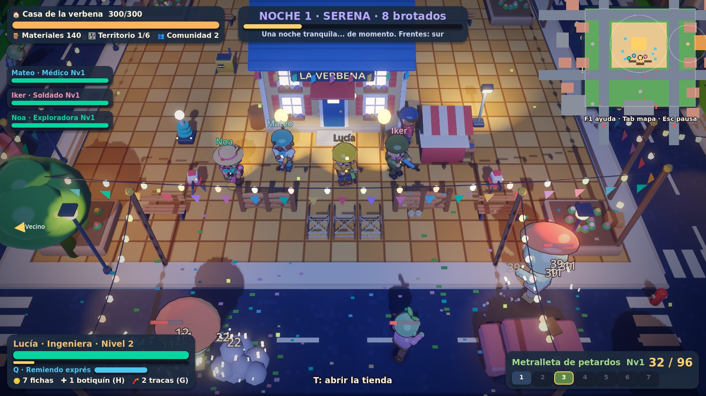
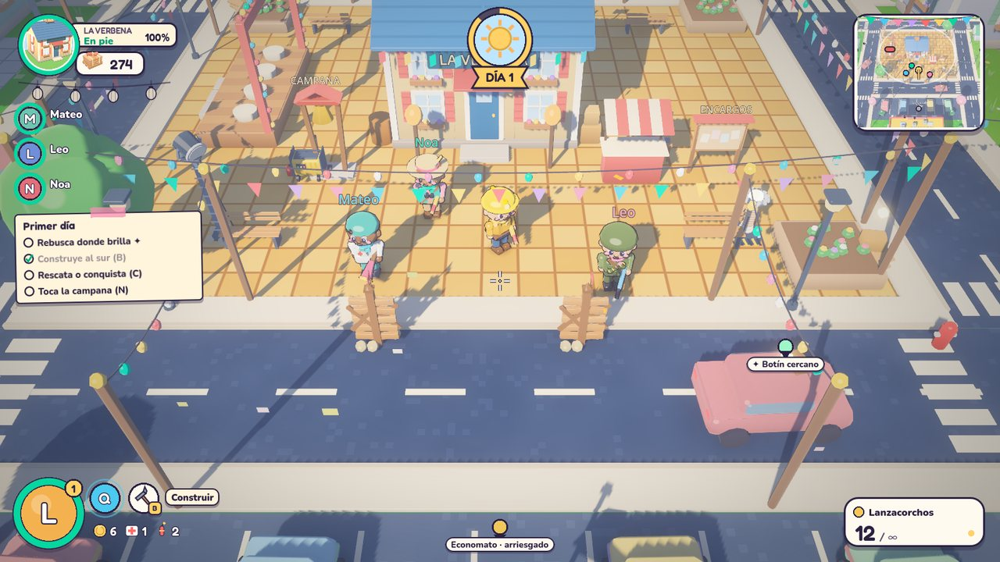

# La última verbena

Supervivencia cooperativa en 3D para PC, de 1 a 4 jugadores. Las guirnaldas siguen encendidas y los vecinos se han atrincherado en la casa de la verbena. Al anochecer llegan los **brotados**, vecinos convertidos en plantas con malas pulgas. De día hay que rebuscar, rescatar, conquistar la calle y levantar defensas. De noche toca aguantar hasta el amanecer.





## Jugar

Abre `project.godot` con **Godot 4.7** (probado con 4.7.2) y pulsa **F5**. También puedes ejecutar `godot --path .`. Usa el renderizador Forward+. Si la tarjeta gráfica no admite Vulkan, Godot pasa automáticamente al renderizador de compatibilidad.

En el menú escribe tu nombre, elige un oficio y pulsa **Jugar en solitario**.

Para jugar en red, una persona pulsa **Crear partida en red**. El HUD muestra sus IP locales. Hasta tres compañeros escriben esa IP y pulsan **Unirse**, también con la partida ya empezada. Hay que permitir UDP 24680 en el cortafuegos del anfitrión. Por Internet hace falta una dirección accesible o una red privada compartida (Tailscale, ZeroTier…). La partida termina si sale el anfitrión.

| Acción | Control |
| --- | --- |
| Moverse · correr · voltereta | WASD (según la cámara) · Mayús · Espacio |
| Apuntar y disparar · sartenazo | Ratón y clic izquierdo · clic derecho corto o V |
| Acercar o alejar la cámara (de vista táctica a tercera persona) | Rueda del ratón |
| Girar la cámara | Arrastra con el botón derecho |
| Recargar · cambiar de arma | R · 1–7 |
| Rebuscar, reparar, reanimar, liberar, fabricar | Mantener E |
| Habilidad del oficio · traca · botiquín | Q · F · H |
| Modo construcción | B. Luego 1–8 o rueda elige, clic coloca, F mejora, X desmonta y clic derecho sale |
| Tienda (junto a la casa) · conquistar propiedad | T · C |
| Plano del barrio (norte arriba) · señalar un destino | M o Tab · clic en el plano o clic central en el mundo |
| Pedir apoyo en tu posición, también al caer | G |
| Listo para la noche · ayuda · pausa | N · F1 · Esc |

Todas las teclas se cambian en **Ajustes → Controles** y se guardan en `user://ajustes.cfg` junto con la sensibilidad de cámara, los volúmenes (general, efectos y música), el tamaño de la interfaz y las opciones de accesibilidad (sacudidas, destellos y números de daño). La ayuda (F1) muestra siempre las teclas elegidas.

**Coordinación.** Las señales duran ocho segundos, se pueden enviar una cada segundo y medio, aparecen en el mundo con el oficio y la distancia y en el plano y el minimapa. El aviso de brecha indica qué acceso (norte, este, sur u oeste) recibe daño, si se ha perdido una defensa o si golpean la casa, y resalta el mismo lado en los mapas. Reconstruir una defensa en ese lado despeja la brecha.

[Lista de prioridades y criterios de prueba](TODO.md) · [Distribución para Windows](distribution/DISTRIBUCION.md)

## El ciclo de una partida

**Día (preparación).** El reloj marca cuánto falta para el anochecer. El HUD anuncia el evento de la noche y por qué calles entrarán los brotados. Así el equipo puede decidir dónde fortificar. Hay 28 puntos de botín (contenedores, coches, palés, cajas de feria, botiquines de pared y cajas de munición) que se vacían al rebuscarlos y se rellenan al amanecer. Durante el día pueden pasar cosas:

- Un **vecino atrapado** pide ayuda en una casa custodiada. Si lo liberas y lo escoltas, se une a la comunidad. El carpintero da materiales, la enfermera cura en la plaza y el vigía dispara desde el tejado.
- Un **globo de feria** deja caer suministros en algún punto del mapa.
- Una **horda errante** cruza el barrio.
- Brotados sueltos rondan las calles.

Cuando todos pulsan **N**, la noche llega antes.

**Noche (supervivencia).** Los brotados llegan en grupos por los frentes anunciados. Van a por la casa y a por los estandartes de las propiedades conquistadas. La IA usa campos de flujo sobre una cuadrícula de 1 m. Cada brotado compara rodear las defensas con romperlas según su resistencia, persigue a los jugadores que ve y golpea lo que le cierra el paso. Cada noche aplica un evento:

| Evento | Efecto |
| --- | --- |
| Serena | Oleada normal. |
| Apagón | Farolas y defensas eléctricas sin corriente salvo junto a un generador. Solo quedan las linternas. |
| Estampida | Muchos más corredores. |
| Niebla | Bruma lechosa y más trepadores. |
| Tormenta | Lluvia y rayos que caen al azar sobre brotados, defensas y vecinos. |
| Verbena roja | Luna roja: brotados más rápidos y más fichas. |
| Noche de gigantes | Cada cinco noches llega un **Gigantón** que pisa en área y convoca brotados. |

**Amanecer (recuperación).** Llegan las recompensas de las propiedades y de la comunidad. Los caídos vuelven y el botín se repone. Es el momento de comprar, mejorar y reparar antes del siguiente día.

La partida acaba si cae la casa o si todo el equipo queda fuera de combate. Un jugador caído aguanta 30 segundos. Un compañero puede reanimarlo manteniendo E, y él mismo puede levantarse con un botiquín.

## Oficios

| Oficio | Ventajas | Habilidad (Q) |
| --- | --- | --- |
| Ingeniera | Construye un 25 % más barato, repara el doble y sus defensas aguantan un 20 % más. | Remiendo exprés: repara todo lo que tiene cerca. |
| Médico | Cura sin gastar materiales y reanima el doble de rápido. Empieza con dos botiquines. | Ola de tila: cura y levanta a los compañeros cercanos. |
| Soldado | +25 % de daño, recarga rápida y un 50 % más de munición. | Traca final: 6 s de fuego rápido sin gastar balas. |
| Exploradora | Corre más, rebusca el doble de rápido y saca un 50 % más de botín. | Carrerilla: 5 s más rápida y con la mitad de daño. |

Cada oficio sube cinco niveles con su experiencia: matar, reparar, curar, rebuscar, construir o reanimar. Cada nivel da más vida, mejora el oficio y reduce la recarga de la habilidad. Todos pueden construir, reanimar y usar cualquier arma.

## Combate

- **Lanzacorchos** (pistola, munición infinita).
- **Trabuco de confeti** (escopeta de siete perdigones que empuja).
- **Metralleta de petardos** (subfusil).
- **Carabina de feria** (rifle de asalto que atraviesa).
- **Rifle de tómbola** (francotirador que atraviesa filas).
- **Lanzatracas** (explosivos en parábola).
- **Soplete de verbena** (chorro de chispas que quema).

Cada arma tiene cargador, reserva, tiempo de recarga, dispersión, alcance, retroceso, sonido y efectos propios, y se mejora dos veces en la tienda. El rifle y el lanzatracas necesitan la Comisaría. El soplete necesita la Gasolinera. Además hay sartenazo cuerpo a cuerpo, tracas arrojadizas, golpes críticos y bonificación contra brotados deslumbrados por un foco.

Los brotados mueren en una explosión de confeti y hojas. Los números de daño, los destellos al impactar, las sacudidas de cámara y los efectos de luz refuerzan cada disparo sin perder el tono animado.

## Brotados

| Tipo | Rasgo |
| --- | --- |
| Brotado | El común, con un brote en la cabeza. |
| Corredor | Rápido y frágil, con sudadera. |
| Cabezudo | Enorme cabeza con sombrero de seta. Resistente y pega fuerte. |
| Derribador | Cono de tráfico y una viga. Destroza barricadas y prefiere atravesar muros. |
| Trepador | Brazos largos. Escala las defensas en lugar de romperlas. |
| Escupidor | Barriga hinchada y flor en la cabeza. Escupe a distancia. |
| Petardero | Chaleco de petardos. Explota al acercarse o al morir y daña también a otros brotados. |
| Gigantón | Gigante de feria coronado. Jefe de oleada. |

Los tipos aparecen poco a poco y se combinan según la noche. La dificultad crece con nuevas mezclas, más frentes, eventos y presión sobre el territorio, y no solo con más vida.

## Construcción y territorio

Se construye en cuadrícula, en cualquier casilla libre a menos de 11,5 m de la casa o a 7,5 m del estandarte de una propiedad conquistada. Una barricada de madera rodeada de muros se convierte en tramo de muro continuo.

| Defensa | Función | Niveles |
| --- | --- | --- |
| Barricada | Bloquea. Los vecinos la saltan. | Madera → tablones con sacos → chapa |
| Alambrada | Frena y araña. | 3 |
| Bobina | Descarga en cadena. | 3 |
| Torreta | Dispara sola y gira hacia el blanco. | 3 |
| Generador | Da corriente en los apagones y acelera las torretas cercanas. | 2 |
| Foco | Ralentiza y deslumbra. Los brotados iluminados reciben más daño. | 2 |
| Banco de taller | Repara las defensas cercanas y fabrica tracas. | 2 |
| Mina de petardos | Explota al pisarla. Un solo uso. | 1 |

Hay seis propiedades conquistables. Cada una tiene su estandarte, su ventaja y sus guardianes: hay que despejarlos de día antes de pagar la conquista.

- **Taller:** defensas más baratas y reparación de la casa al amanecer.
- **Dispensario:** curas y botiquines.
- **Economato:** fichas.
- **Almacén:** materiales.
- **Gasolinera:** corriente garantizada y soplete.
- **Comisaría:** armas pesadas, munición y tracas.

Cada conquista encarece la siguiente, añade brotados a cada noche y suma un estandarte que los brotados intentarán derribar. Si cae, la propiedad se pierde hasta que se reconquiste.

**Economía.** Los materiales son del equipo: sirven para construir, reparar, conquistar y reforzar la casa. Las fichas son de cada jugador: sirven para armas, mejoras, munición, botiquines, tracas y la mejora colectiva de la casa.

## Dirección artística

El estilo toma como referencia la paleta y los volúmenes suaves de los juegos de Nintendo citados en el encargo, con una identidad propia: un barrio español en fiestas.

- **Sombreado toon propio** (`game/shaders/toon.gdshader`): terminador suave, luz de borde, brillo plástico, sombras teñidas por la luz ambiente y ventanas que se encienden solas al anochecer.
- **Modelado procedural** (`game/view/kit.gd`): cajas biseladas, cilindros, elipsoides y tejados de teja. El barrio se combina en pocas mallas por zona, con color por vértice.
- **Personajes chibi** con ojos brillantes, rubor y equipo de oficio (casco con linterna, cofia y bolsa médica, casco y canana, sombrero de explorador con pluma). Animación procedural de pasos, apuntado, retroceso, recarga, voltereta, sartenazo, parpadeo, caída y reanimación. Contorno fino para leerlos desde la cámara alta.
- **Ciclo de día y noche** continuo: mañana, mediodía, tarde dorada, atardecer rosado y noche azul con luna, estrellas, farolas, guirnaldas, farolillos y linternas.
- **Clima:** nubes que proyectan sombra sobre el césped, lluvia con suelo mojado, niebla lechosa, relámpagos y luna roja.
- **Elementos vivos:** césped y flores que se mecen, árboles con viento, banderines de papel picado, pétalos y hojas por el aire, mariposas de día, luciérnagas de noche, humo de chimeneas y fuente con agua animada.
- **Combate:** trazadoras, fogonazos con luz, chispas, confeti, humo, ondas expansivas, rayos y números de daño.
- **Posproceso:** bloom, oclusión ambiental, niebla de altura, desenfoque de profundidad en Ultra, viñeta, pulso rojo al recibir daño y desaturación al caer.

Todo se genera en código, sin texturas ni modelos externos, y el audio también: disparos, gruñidos, explosiones, campanas del amanecer y música en bucle (vals de verbena de día, pulso tenso de noche que crece con el combate).

## Arquitectura

| Archivo | Responsabilidad |
| --- | --- |
| `game/data.gd` | Datos de diseño: oficios, armas, brotados, defensas, propiedades, eventos y supervivientes. |
| `game/map.gd` | Trazado del barrio alineado a la cuadrícula de navegación. |
| `game/nav.gd` | Cuadrícula, colisiones, rayos y campos de flujo (Dijkstra con cola de cubos, reconstrucción diferida). |
| `game/match.gd` | Simulación autoritativa: fases, IA, combate, economía, territorio y eventos. Genera instantáneas compactas y eventos con número de serie. |
| `game/main.gd` | Sesión ENet, entradas, predicción local del movimiento y reparto de eventos a efectos, audio e interfaz. |
| `game/view/camera_rig.gd` | Cámara continua de vista táctica a tercera persona, giro, zoom y distancia a las fachadas. |
| `game/settings.gd` | Preferencias y controles reasignables con guardado versionado y escritura segura. |
| `game/view/world.gd` | Barrio, vegetación, decoración, luces, ciclo de día y clima. |
| `game/view/actors.gd`, `rig.gd` | Héroes, brotados, defensas, botín, estandartes, globos, supervivientes y su animación. |
| `game/view/fx.gd` | Efectos con reservas de objetos reutilizables. |
| `game/audio.gd` | Síntesis de efectos y música renderizada en un hilo de trabajo. |
| `game/interface.gd` | Menú, ajustes, ayuda, HUD, minimapa, mapa, tienda, construcción, pausa y final. |

**Red.** El anfitrión decide todo lo que afecta al resultado. Cada cliente predice su propio movimiento y sus fogonazos para que el control responda sin retraso, y envía posición, puntería y botones a 30 Hz. El anfitrión valida la velocidad y corrige si hace falta. Las instantáneas viajan comprimidas a 20 Hz: unos 2 KB con decenas de brotados. Los eventos (disparos, impactos, construcciones…) llevan número de serie y se repiten durante varias instantáneas, así que una pérdida de paquete no borra efectos.

**Rendimiento.** Hay un máximo de 72 brotados activos. Las búsquedas de vecinos usan cubos espaciales y las mallas compartidas se precalculan al cargar. La vegetación se dibuja con MultiMesh y los efectos reutilizan nodos. Los ajustes gráficos tienen cuatro niveles: sombras, oclusión ambiental, antialiasing, escala de render, densidad de césped, niebla volumétrica y desenfoque. En la prueba de estrés, la lógica y la presentación tardan unos 7 ms de CPU por fotograma con más de 70 brotados.

## Verificación

```bash
godot --headless -s tests/match_test.gd
```

```bash
godot --headless -s tests/soak_test.gd
```

```bash
godot --headless -s tests/camera_test.gd
```

```bash
godot --headless -s tests/coop_test.gd
```

```bash
godot --headless -s tests/network_test.gd -- --host
```

- `match_test.gd` comprueba 29 reglas: construcción, rutas alrededor de muros, rebuscar, tienda, disparo y recarga, conquista, reanimación, habilidades, ciclo de fases, derribadores y derrotas.
- `soak_test.gd` hace que cuatro bots jueguen varias noches y mide el coste de cada paso de simulación y el tamaño de las instantáneas.
- `camera_test.gd` comprueba el movimiento relativo a la cámara girada, los límites de giro y zoom, la parada ante las fachadas y que el puntero coincide con el plano de tiro.
- `coop_test.gd` comprueba el plano (proyección, clic para señalar sin disparar), la frecuencia, los límites y la caducidad de las señales, las brechas y su limpieza, y la petición de ayuda al caer.
- `network_test.gd` levanta el anfitrión. Lanza tres veces `godot --headless -s tests/network_test.gd` en otras terminales en los 15 segundos siguientes: todos envían una señal, cada cliente construye una barricada y los cuatro procesos deben ver las tres barricadas y las cuatro señales.

## Siguientes pasos

Las prioridades, con sus criterios de prueba, están en [TODO.md](TODO.md).
